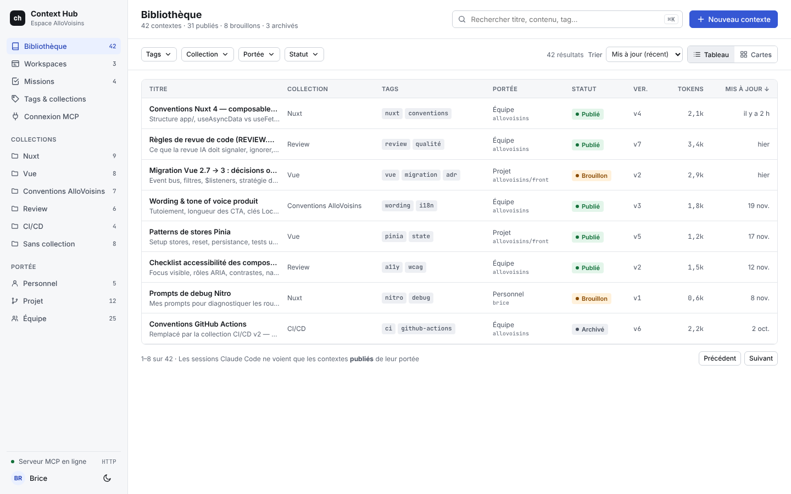
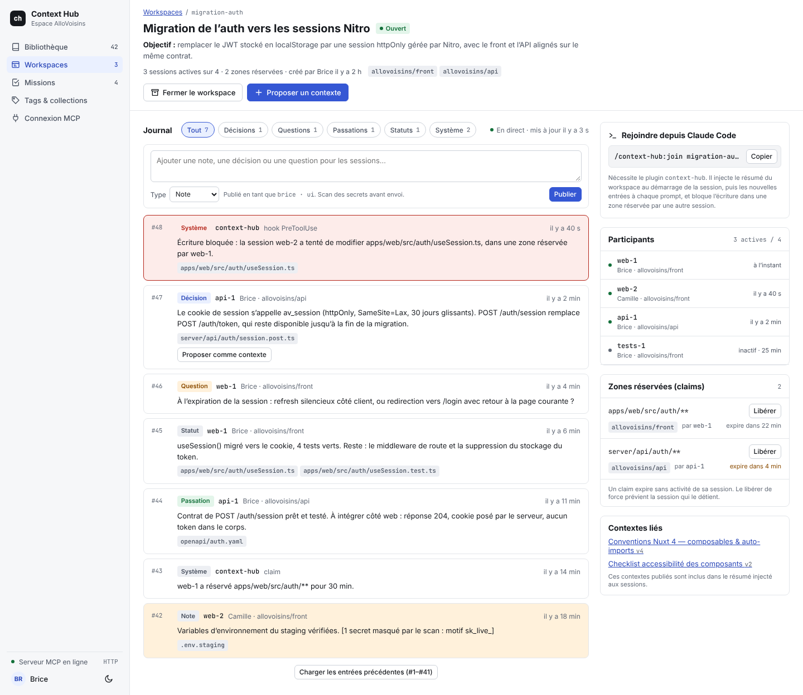

# Context Hub

[Français](README.md) | **English**

Context Hub centralizes **contexts**: reusable, versioned and shared Markdown documents (coding
conventions, architecture rules, procedures…) that **Claude Code** sessions read through an **MCP**
server. It also coordinates several Claude Code sessions working on the same topic at the same time
with **Workspaces**: a shared log and reserved areas of code.

> The user interface, the linked documentation (`apps/server/README.md`, plugin README, `SPEC.md`)
> and the code comments are in French. UI labels are quoted in French below, with a translation.



## Table of contents

- [What it is for](#what-it-is-for)
- [Features](#features)
- [Architecture](#architecture)
- [Technologies](#technologies)
- [Prerequisites](#prerequisites)
- [Quick start](#quick-start)
- [Configuration](#configuration)
- [Connecting Claude Code](#connecting-claude-code)
- [Database](#database)
- [Commands](#commands)
- [Quality and tests](#quality-and-tests)
- [Security](#security)
- [Troubleshooting](#troubleshooting)
- [Repository layout](#repository-layout)
- [Documentation and limitations](#documentation-and-limitations)

## What it is for

| Problem                                                                                 | How Context Hub solves it                                                                                                     |
| --------------------------------------------------------------------------------------- | ----------------------------------------------------------------------------------------------------------------------------- |
| Team conventions are copied into every repo or every prompt, and drift apart over time. | A context is written **once**, published, then read by every Claude Code session through MCP.                                 |
| A modified context changes the agent's behavior without anyone noticing.                | Every publication creates an **immutable version**; a version can be pinned (`…@4`).                                          |
| A shared document may contain a secret or a malicious instruction.                      | Secrets and suspicious instructions are **scanned** while editing and, server-side, on publication; content remains **data**. |
| Parallel Claude Code sessions step on each other's toes.                                | **Workspaces**: a shared log, decisions, handoffs and **claims** that block writes to a reserved area.                        |

Example, in a Claude Code prompt:

```text
Apply @context-hub:context://nuxt/conventions-nuxt-4 to this component.
```

## Features

### Contexts (web UI)

- **Library** (`/`): table or card view, full-text search, filters by status, scope, tag and
  collection, sorting.
- **Detail** (`/contexts/:id`): rendered Markdown preview or raw source, version history, token
  estimate, MCP reads over 7 days, “Utiliser dans Claude Code” (use in Claude Code) instructions
  (CLI or `.mcp.json`).
- **Create and edit** (`/contexts/new`, `/contexts/:id/edit`):
  - draft autosave (local copy every 2 s);
  - tag autocompletion;
  - live secret scanning, with a suggested replacement by `${VARIABLE}`;
  - **version conflict** detection when someone else published in the meantime.
- **Lifecycle**: draft → published → archived. Every publication creates an immutable version.
- **Scopes**: `personal` (visible to its owner only), `project` (attached to an `org/name` repo) and
  `team` (the whole team).
- **Tags and collections** (`/taxonomy`): inline rename, tag merge with preview, collection
  deletion.
- **MCP page** (`/mcp`): how to connect Claude Code to the server.
- Light and dark themes.

### Workspaces (live sessions)



- **List** (`/workspaces?status=open|closed|all`) and **detail** (`/workspaces/:slug`), with the log
  polled every 3 s (paused while the tab is hidden).
- **Log**: typed entries `note`, `decision`, `question`, `handoff` and `status`, numbered and
  attributed to their session (e.g. `web-1 (Brice · allovoisins/front)`). Secrets are **replaced**
  before storage and suspicious instructions are flagged.
- **Claims**: a session reserves an area of code (glob, e.g. `apps/web/src/auth/**`) for 30 min by
  default. Two overlapping claims are rejected, atomically.
- **Participants**: active or inactive sessions, repos involved.
- **Linked contexts** and “Proposer un contexte” (propose a context) from a log entry (creates a
  draft, never published automatically).
- **Lifecycle**: open → inactive (7 days without activity) → closed (manually, or automatically after
  30 days).

### Claude Code plugin `context-hub`

- Commands `/context-hub:join`, `/context-hub:new`, `/context-hub:status` and `/context-hub:leave`.
- Hooks:
  - when a session resumes: workspace summary;
  - on every prompt: sync of new entries;
  - before every file write: **blocked** if the area is reserved by another session.
- A skill that teaches Claude how to collaborate (claim, post a decision, hand off).

Details (in French): [`packages/claude-plugin/README.md`](packages/claude-plugin/README.md).

## Architecture

```
                       ┌──────────────────────────────┐
 Browser ─────────────▶│ Vite (apps/web, :5173)       │
                       │  /api proxy → injects the    │
                       │  token (Node side only)      │
                       └──────────────┬───────────────┘
                                      │ HTTP /api
                                      ▼
 Claude Code ─── MCP ───▶ ┌──────────────────────────────┐      ┌──────────────────┐
  (sessions)              │ Hono server (apps/server,    │─────▶│ SQLite           │
 Plugin (hooks) ─ REST ─▶ │ :8787)                       │      │ data/context-    │
                          │  /api/*  REST + OpenAPI      │      │ hub.db (FTS5)    │
                          │  /mcp    Streamable HTTP     │      └──────────────────┘
                          └──────────────────────────────┘
                                      ▲
                      pure rules, types, zod schemas
                                      │
                          packages/domain (shared by web / server)
```

| Package                  | Role                                                                                                                                                      |
| ------------------------ | --------------------------------------------------------------------------------------------------------------------------------------------------------- |
| `apps/web`               | React UI. Two data sources: `memory` (fixtures, no server) or `http` (server API). Layers `ui → application → domain` and `infrastructure → application`. |
| `apps/server`            | Node server (Hono): REST API `/api`, MCP server `/mcp`, SQLite persistence (Drizzle), hourly workspace maintenance.                                       |
| `packages/domain`        | `@context-hub/domain`: types, zod schemas and pure business rules (scan, versions, claims, digest…), demo fixtures. Only dependency: `zod`.               |
| `packages/claude-plugin` | Claude Code plugin `context-hub`: dependency-free ESM JavaScript, run by `node` in users' repos.                                                          |
| `design-kit/`            | Read-only design reference: `SPEC.md` (source of truth), 30 PNG and HTML mockups, tokens.                                                                 |

Rules:

- The web app only knows the server through its **OpenAPI contract**.
  `apps/server/openapi.json` (committed) → `apps/web/src/infrastructure/http/openapi.d.ts`
  (generated types), consumed by `openapi-fetch`.
- Dependency rules between packages and between layers are **enforced** by ESLint
  (`eslint-plugin-boundaries`) and checked by architecture tests.

## Technologies

| Area    | Technologies                                                                                                                                                                                                                                                  |
| ------- | ------------------------------------------------------------------------------------------------------------------------------------------------------------------------------------------------------------------------------------------------------------- |
| Common  | Node **24.22.1** (pinned by Volta and `.nvmrc`), pnpm **12** (workspaces), TypeScript **6** in strict mode (`noUncheckedIndexedAccess`, `exactOptionalPropertyTypes`)                                                                                         |
| Web     | React **19**, React Router **8**, TanStack Query **5**, Vite, SCSS modules (`sass-embedded`), `openapi-fetch` and `openapi-typescript`, `react-markdown` + `remark-gfm` + `rehype-sanitize`, Inter and JetBrains Mono fonts (`@fontsource`)                   |
| Server  | Hono **4** (`@hono/node-server`), `@hono/zod-openapi` (typed routes and generated OpenAPI), MCP SDK **v2** (`@modelcontextprotocol/server`, protocols 2025-11-25 and 2026-07-28), Drizzle ORM + `drizzle-kit`, `better-sqlite3`, FTS5 full-text search, `tsx` |
| Domain  | `zod` **4**                                                                                                                                                                                                                                                   |
| Plugin  | ESM JavaScript typed with JSDoc (`checkJs`), native `fetch`, no dependencies                                                                                                                                                                                  |
| Tooling | Vitest (jsdom, Testing Library), ESLint **9** (`typescript-eslint`, `boundaries`, `jsx-a11y`, `react-hooks`), Prettier, GitHub Actions                                                                                                                        |

## Prerequisites

- **Node 24.22.1**. Volta selects it automatically; otherwise `nvm use` reads `.nvmrc`.
- **pnpm 12**: `corepack enable` installs the version declared in `packageManager`.
- **Claude Code**, optional: to read contexts through MCP and use the plugin.
- A C++ compiler may be needed if `better-sqlite3` has no prebuilt binary for your platform.

## Quick start

### Option A: demo without a server (in-memory data)

Ideal to discover the UI: data comes from the mockup fixtures, and the clock is frozen at
2026-11-23 11:12.

```sh
pnpm install
pnpm --filter @context-hub/web dev     # http://localhost:5173
```

Without `apps/web/.env.local`, the data source is `memory`. The `?mock=` URL parameter reproduces the
mockup states:

| `?mock=`       | Effect                           |
| -------------- | -------------------------------- |
| `empty`        | No data (empty states)           |
| `loading`      | Endless loading (skeletons)      |
| `error`        | Server error                     |
| `slow`         | Slow responses                   |
| `conflict`     | Version conflict on save         |
| `ws-empty`     | No workspace                     |
| `ws-closed`    | Closed workspace                 |
| `ws-forbidden` | Workspace access forbidden (403) |

Example: `http://localhost:5173/?mock=empty`.

### Option B: full application (UI + server + MCP)

1. **Install dependencies**:

   ```sh
   pnpm install
   ```

2. **Create the database**, either:

   ```sh
   pnpm --filter @context-hub/server db:seed   # demo data: 42 contexts, tags, collections, workspaces
   pnpm --filter @context-hub/server db:init   # empty database: dev user and system collection
   ```

   The command prints an **API token** (`chub_…`) **only once**. Copy it: only its hash is stored, it
   cannot be recovered. Lost token: `pnpm --filter @context-hub/server db:token` issues a new one
   without touching the data.

3. **Configure the web app**:

   ```sh
   cp apps/web/.env.example apps/web/.env.local
   ```

   Then in `apps/web/.env.local`:

   ```sh
   VITE_DATA_SOURCE=http
   CONTEXT_HUB_DEV_TOKEN=chub_…   # the token from step 2
   ```

4. **Start** the server and the web app in parallel:

   ```sh
   pnpm dev
   ```

   - UI: <http://localhost:5173>
   - API: <http://127.0.0.1:8787/api> (contract: `/api/openapi.json`)
   - MCP: <http://127.0.0.1:8787/mcp>

5. **Check**:

   ```sh
   curl http://127.0.0.1:8787/api/health   # {"status":"ok"}
   ```

## Configuration

`*.env.local` files are ignored by git. Copy the `.env.example` files to start from the defaults.

### Server: `apps/server/.env.local`

> The server reads **only** `.env.local` (`--env-file-if-exists=.env.local`), not `.env`.

| Variable                     | Default                     | Role                                                                      |
| ---------------------------- | --------------------------- | ------------------------------------------------------------------------- |
| `CONTEXT_HUB_HOST`           | `127.0.0.1`                 | Listening interface (local only by default).                              |
| `CONTEXT_HUB_PORT`           | `8787`                      | HTTP port.                                                                |
| `CONTEXT_HUB_WEB_ORIGIN`     | `http://localhost:5173`     | Only origin allowed by CORS on `/api`.                                    |
| `CONTEXT_HUB_WORKSPACE_NAME` | `Espace AlloVoisins`        | Space name displayed in the UI.                                           |
| `CONTEXT_HUB_DB_PATH`        | `data/context-hub.db`       | SQLite database, relative to `apps/server` (folder created if needed).    |
| `CONTEXT_HUB_ALLOWED_HOSTS`  | `localhost,127.0.0.1,[::1]` | Hosts accepted in the `Host` header on `/mcp` (DNS rebinding protection). |

### Web: `apps/web/.env.local`

| Variable                 | Default                 | Role                                                                                                     |
| ------------------------ | ----------------------- | -------------------------------------------------------------------------------------------------------- |
| `VITE_DATA_SOURCE`       | `memory`                | `memory` (fixtures, `?mock=*`) or `http` (server API through the `/api` proxy).                          |
| `VITE_MCP_URL`           | (placeholder `[HÔTE]`)  | MCP server URL shown in “Utiliser dans Claude Code”.                                                     |
| `CONTEXT_HUB_DEV_TOKEN`  | (none)                  | Token injected by the **Vite proxy** on the Node side. Never exposed to the browser (no `VITE_` prefix). |
| `CONTEXT_HUB_API_TARGET` | `http://127.0.0.1:8787` | Target of the `/api` proxy.                                                                              |

Vite only reads these variables at startup: restart `pnpm dev` after a change.

### Claude Code and plugin: shell variables

| Variable                | Default                 | Role                                                                               |
| ----------------------- | ----------------------- | ---------------------------------------------------------------------------------- |
| `CONTEXT_HUB_TOKEN`     | (none)                  | API token sent as `Authorization: Bearer` by the MCP server and the hooks.         |
| `CONTEXT_HUB_URL`       | `http://127.0.0.1:8787` | Server URL, without `/mcp`.                                                        |
| `CONTEXT_HUB_FAIL_MODE` | `open`                  | Server unreachable during a write: `open` warns without blocking, `closed` blocks. |
| `CONTEXT_HUB_REPO`      | (derived from git)      | Session repo `org/name`; otherwise `git remote get-url origin`.                    |

## Connecting Claude Code

Export the token in the shell that starts Claude Code (e.g. `~/.zshrc`), never in a versioned file:

```sh
export CONTEXT_HUB_TOKEN=chub_…
```

You connect **once and for all**: Claude Code reloads its MCP configuration on every start. There
are three ways to declare it:

| Method                                 | Scope                            | Token                                     | Provides                              |
| -------------------------------------- | -------------------------------- | ----------------------------------------- | ------------------------------------- |
| **`context-hub` plugin** (recommended) | every session, every repo        | read from the environment, never written  | MCP, `/context-hub:*` commands, hooks |
| Project `.mcp.json`                    | one repo (copy it into each one) | read from the environment, never written  | MCP only                              |
| `claude mcp add --scope user`          | every session, every repo        | written in clear text to `~/.claude.json` | MCP only                              |

**Recommendation: the plugin** (see [Workspaces (plugin)](#workspaces-plugin)). A single install,
nothing to redo when the token changes, and the whole surface at once. A `.mcp.json` remains useful
for a shared repo where the team wants MCP without installing the plugin. Do not combine two
methods: the server would be declared twice.

On each use, whatever the method, all that remains is:

1. the server running on `:8787` (`pnpm dev`);
2. `CONTEXT_HUB_TOKEN` exported (one line in `~/.zshrc` is enough);
3. if the server starts after Claude Code: `/mcp`, then reconnect `context-hub` (or restart
   `claude`).

### Reading contexts (MCP only)

Option 1, a project `.mcp.json`, where Claude Code expands `${VAR}` at runtime (the token is written
nowhere):

```json
{
  "mcpServers": {
    "context-hub": {
      "type": "http",
      "url": "${CONTEXT_HUB_URL:-http://127.0.0.1:8787}/mcp",
      "headers": { "Authorization": "Bearer ${CONTEXT_HUB_TOKEN}" }
    }
  }
}
```

Option 2, the command below. Beware: the shell expands the variable, so the token is written in clear
text to `~/.claude.json`.

```sh
claude mcp add --transport http --scope user context-hub http://127.0.0.1:8787/mcp \
  --header "Authorization: Bearer $CONTEXT_HUB_TOKEN"
```

MCP surface:

- resources `context://{slug}` and `context://{slug}@{version}`;
- tools `search_contexts` and `get_context`;
- tools `workspace_*` and `propose_context`;
- resource `workspace://{slug}`.

Details, and testing with MCP Inspector, are in [`apps/server/README.md`](apps/server/README.md)
(in French).

### Workspaces (plugin)

In Claude Code:

```text
/plugin marketplace add /path/to/context-hub
/plugin install context-hub@context-hub
```

The plugin declares the MCP server itself: remove any manual entry (`claude mcp remove context-hub`).
Then:

```text
/context-hub:new "Auth migration" web-1     # creates a workspace and joins it
/context-hub:join auth-migration api-1      # from another session
/context-hub:status
/context-hub:leave
```

Installation, hooks and limitations: [`packages/claude-plugin/README.md`](packages/claude-plugin/README.md).
Real multi-session test scenario:
[`packages/claude-plugin/TESTING.md`](packages/claude-plugin/TESTING.md).

## Database

SQLite through Drizzle, file `apps/server/data/context-hub.db` by default (ignored by git).

| Command (prefix `pnpm --filter @context-hub/server`) | Role                                                                                                                       |
| ---------------------------------------------------- | -------------------------------------------------------------------------------------------------------------------------- |
| `db:init`                                            | Migrates then prepares an **empty** database and prints a token. Refuses a database that already holds data.               |
| `db:seed`                                            | Migrates then loads the mockup demo data and prints a token. Empty database only.                                          |
| `db:token`                                           | Issues a **new** token for a user of an existing database (`--user`, default `brice`; `--label`). Other tokens stay valid. |
| `db:migrate`                                         | Applies migrations (`apps/server/drizzle/`).                                                                               |
| `db:generate`                                        | Generates a migration after a Drizzle schema change.                                                                       |

- The server applies migrations at startup.
- An hourly job closes workspaces inactive for 30 days and purges expired claims.
- **Start from scratch**: stop the server, delete `apps/server/data/context-hub.db*`, run `db:init`
  or `db:seed` again, then copy the new token into `apps/web/.env.local` and `CONTEXT_HUB_TOKEN`.

## Commands

At the root:

| Command             | Role                                                                       |
| ------------------- | -------------------------------------------------------------------------- |
| `pnpm install`      | Dependencies of the whole monorepo.                                        |
| `pnpm dev`          | Server (`:8787`) and web app (`:5173`) in parallel, with reload.           |
| `pnpm build`        | Builds every package (the web app runs its typecheck before `vite build`). |
| `pnpm -r typecheck` | `tsc` for every package.                                                   |
| `pnpm -r lint`      | ESLint, zero warnings tolerated.                                           |
| `pnpm -r test`      | Vitest for every package, one package at a time.                           |
| `pnpm format`       | Prettier on the whole repo (`pnpm format:check` in CI).                    |

Per package (`pnpm --filter @context-hub/<package> <script>`):

| Package         | Useful scripts                                                                                               |
| --------------- | ------------------------------------------------------------------------------------------------------------ |
| `web`           | `dev`, `build`, `preview`, `test`, `test:watch`, `test:contract`, `api:generate` (regenerates OpenAPI types) |
| `server`        | `dev`, `start`, `test`, `test:watch`, `db:*`, `openapi:export` (regenerates `openapi.json`)                  |
| `domain`        | `test`, `test:watch`, `typecheck`, `lint`                                                                    |
| `claude-plugin` | `test`, `typecheck` (`tsc --checkJs`), `lint`; validation: `claude plugin validate packages/claude-plugin`   |

**After an API change**: `pnpm --filter @context-hub/server openapi:export`, then
`pnpm --filter @context-hub/web api:generate`. An architecture test fails if the generated types are
out of date.

## Quality and tests

Every task ends with the gate:

```sh
pnpm -r typecheck && pnpm -r lint && pnpm -r test
```

| Test type         | Where                                 | What it checks                                                                         |
| ----------------- | ------------------------------------- | -------------------------------------------------------------------------------------- |
| Domain unit tests | `packages/domain/src/**/*.test.ts`    | Pure rules: scan, versions, claim overlap (checked exhaustively), digest…              |
| Server            | `apps/server/src/**/*.test.ts`        | Use cases, REST routes, MCP surface (real MCP client), migrations.                     |
| Concurrency       | `apps/server/…/*.concurrency.test.ts` | Concurrent SQLite transactions (worker threads): log numbering, atomic claims.         |
| UI                | `apps/web/src/**/*.test.tsx`          | Screens and mockup states with Testing Library (jsdom, `TZ=Europe/Paris`).             |
| HTTP contract     | `apps/web/tests/contract`             | In-memory and HTTP repositories honor the same contract, against a real server.        |
| Architecture      | `*/tests/architecture`                | Dependencies between packages and layers, hard-coded colors, up-to-date OpenAPI types. |
| Plugin            | `packages/claude-plugin/tests`        | Handlers, `hook.mjs` run as a process, no dependencies.                                |

GitHub Actions CI (`.github/workflows/ci.yml`) runs on every PR and every push to `main`:

- `format:check`;
- lint;
- typecheck;
- build;
- the tests.

## Security

- **Tokens**: 256 random bits, `chub_` prefix. Only their sha-256 hash is stored. Every route
  requires `Authorization: Bearer`, except `/api/health`.
- **Content is untrusted data**, everywhere. Markdown is rendered sanitized (`rehype-sanitize`). The
  MCP server presents contexts and log entries as attributed data, never as instructions.
- **Secrets**:
  - scanned while editing;
  - **rescanned by the server** on publication (rejected with 422);
  - in workspaces, secrets are replaced by `[secret masqué]` (secret masked) before storage.
- **`/mcp`**: `Host` (DNS rebinding) and `Origin` validation. An MCP session is bound to the user who
  opened it.
- **Network**: listens on `127.0.0.1` by default, CORS limited to the web app's origin.
- **Logs**: never any context content, entry body, request body or token.

## Troubleshooting

**“Accès refusé par le serveur Context Hub” (access denied by the Context Hub server) in the UI (401)**

The token in `apps/web/.env.local` does not exist in the database used by the server. This happens,
for example, after recreating the database or changing `CONTEXT_HUB_DB_PATH`. Check:

```sh
grep CONTEXT_HUB_DEV_TOKEN apps/web/.env.local
curl -s -o /dev/null -w '%{http_code}\n' -H "Authorization: Bearer <token>" \
  http://127.0.0.1:8787/api/workspaces      # expect 200
```

A lost token cannot be recovered, but a new one can be issued without losing any data:

```sh
pnpm --filter @context-hub/server db:token   # prints the new token only once
```

Copy it into `CONTEXT_HUB_DEV_TOKEN` (and `CONTEXT_HUB_TOKEN`), then **restart `pnpm dev`**: Vite
does not reload `.env.local` on the fly. If `CONTEXT_HUB_DB_PATH` is set, the command must see the
same value as the server.

**The `context-hub` MCP server does not show up or fails in Claude Code**

- Check that the server is running: `curl http://127.0.0.1:8787/api/health`.
- Check that `CONTEXT_HUB_TOKEN` is **exported** in the shell that started Claude Code.
- `/mcp` in Claude Code shows the connection status.
- A server declared in `.mcp.json` must be approved (`claude mcp reset-project-choices` to undo a
  refusal).

**Port already in use (`EADDRINUSE` on 8787 or 5173)**

An old server is still running. `ss -ltnp | grep -E '8787|5173'` gives its PID. Otherwise, change
`CONTEXT_HUB_PORT`, and update `CONTEXT_HUB_API_TARGET` and `VITE_MCP_URL` accordingly.

**`pnpm install` refuses a build script**

Only `better-sqlite3` and `esbuild` are allowed (`allowBuilds` in `pnpm-workspace.yaml`). If
`better-sqlite3` fails to load, the Node version does not match its binary: `nvm use` or Volta, then
`pnpm install`.

**API type errors in the web app**

Regenerate the contract: `openapi:export` on the server, then `api:generate` on the web app.

## Repository layout

```
context-hub/
├── apps/
│   ├── web/                    # React UI (Vite)
│   │   ├── src/application/    #   ports (repository interfaces) and use cases
│   │   ├── src/infrastructure/ #   in-memory (fixtures, ?mock=) and http (openapi-fetch, generated types)
│   │   ├── src/ui/             #   app (routes, layout), components, features/*, styles (tokens, themes)
│   │   └── tests/              #   architecture and HTTP contract
│   └── server/                 # Hono server
│       ├── src/application/    #   use cases (contexts, taxonomy, workspaces, auth, MCP)
│       ├── src/infrastructure/ #   db (Drizzle, stores, seed, CLI), config, events, logging
│       ├── src/interfaces/     #   http (REST routes + OpenAPI) and mcp (resources and tools)
│       ├── drizzle/            #   SQL migrations
│       └── openapi.json        #   API contract (committed)
├── packages/
│   ├── domain/                 # @context-hub/domain: types, zod schemas, pure rules, fixtures
│   └── claude-plugin/          # Claude Code plugin (commands, hooks, scripts, skills)
├── design-kit/                 # SPEC.md, mockups, tokens (read-only)
├── .claude-plugin/             # local plugin marketplace
├── .github/workflows/ci.yml    # CI
├── CLAUDE.md                   # monorepo rules (for agents and humans)
└── ROADMAP.md                  # out of scope for v1
```

## Documentation and limitations

All the documents below are in French.

| Document                                                               | Content                                                          |
| ---------------------------------------------------------------------- | ---------------------------------------------------------------- |
| [`design-kit/SPEC.md`](design-kit/SPEC.md)                             | **Source of truth**: domain, design system, screens, Workspaces. |
| [`apps/server/README.md`](apps/server/README.md)                       | Server: MCP surface, connecting Claude Code, MCP Inspector.      |
| [`packages/claude-plugin/README.md`](packages/claude-plugin/README.md) | Plugin: installation, session identity, hooks, limitations.      |
| [`CLAUDE.md`](CLAUDE.md), `apps/*/CLAUDE.md`                           | Coding conventions, dependency rules, prohibitions.              |
| [`ROADMAP.md`](ROADMAP.md)                                             | Out of scope for v1 and accepted residual risks.                 |

Main v1 limitations:

- **Authentication**: Bearer tokens only, no OAuth. The UI only authenticates in development,
  through the Vite proxy.
- **A single server instance** and a single team.
- **No deployment and no Docker**.
- **Workspace UI updates** by polling, not SSE.
- **Plugin**: a write through Bash (`sed -i`, `>`) is not blocked.
