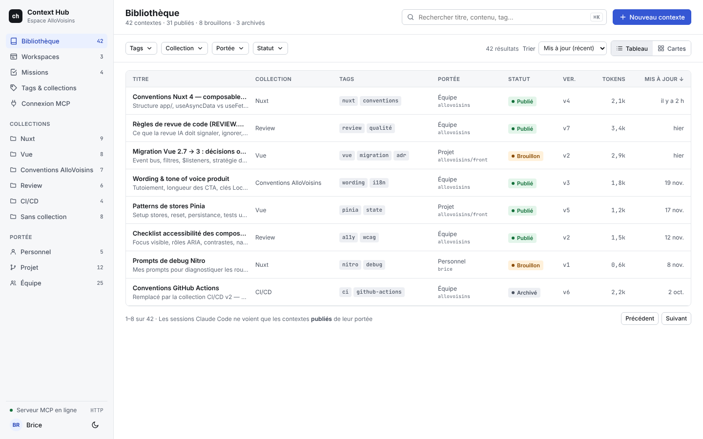
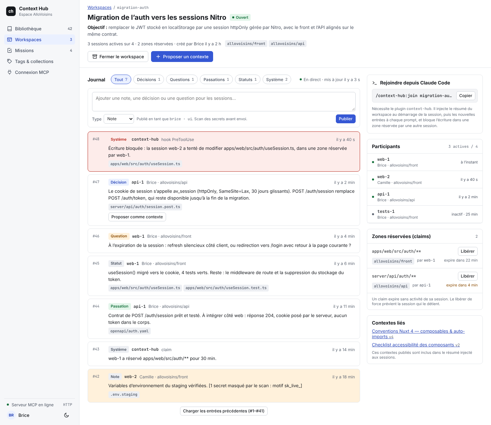

# Context Hub

Context Hub centralise des **contextes** : des documents Markdown réutilisables, versionnés et
partagés (conventions de code, règles d'architecture, procédures…), que les sessions **Claude Code**
lisent via un serveur **MCP**. Il coordonne aussi plusieurs sessions Claude Code qui travaillent en
même temps sur un même sujet grâce aux **Workspaces** : un journal partagé et des zones de code
réservées.



## Sommaire

- [À quoi ça sert](#à-quoi-ça-sert)
- [Fonctionnalités](#fonctionnalités)
- [Architecture](#architecture)
- [Technologies](#technologies)
- [Prérequis](#prérequis)
- [Démarrage rapide](#démarrage-rapide)
- [Configuration](#configuration)
- [Brancher Claude Code](#brancher-claude-code)
- [Base de données](#base-de-données)
- [Commandes](#commandes)
- [Qualité et tests](#qualité-et-tests)
- [Sécurité](#sécurité)
- [Dépannage](#dépannage)
- [Structure du dépôt](#structure-du-dépôt)
- [Documentation et limites](#documentation-et-limites)

## À quoi ça sert

| Problème                                                                                               | Réponse de Context Hub                                                                                                               |
| ------------------------------------------------------------------------------------------------------ | ------------------------------------------------------------------------------------------------------------------------------------ |
| Les conventions d'équipe sont recopiées dans chaque repo ou chaque prompt, et divergent avec le temps. | Un contexte est écrit **une fois**, publié, puis lu par toutes les sessions Claude Code via MCP.                                     |
| Un contexte modifié change le comportement de l'agent sans qu'on le sache.                             | Chaque publication crée une **version immuable** ; on peut figer une version (`…@4`).                                                |
| Un document partagé peut contenir un secret ou une instruction malveillante.                           | **Scan** des secrets et des instructions suspectes à l'édition et, côté serveur, à la publication ; le contenu reste une **donnée**. |
| Plusieurs sessions Claude Code parallèles se marchent dessus.                                          | Les **Workspaces** : journal commun, décisions, passations et **claims** qui bloquent l'écriture dans une zone réservée.             |

Exemple, dans un prompt Claude Code :

```text
Applique @context-hub:context://nuxt/conventions-nuxt-4 à ce composant.
```

## Fonctionnalités

### Contextes (UI web)

- **Bibliothèque** (`/`) : vue tableau ou cartes, recherche plein texte, filtres par statut, portée,
  tag et collection, tri.
- **Détail** (`/contexts/:id`) : aperçu Markdown rendu ou source brute, historique des versions,
  estimation du nombre de tokens, lectures MCP sur 7 jours, instructions « Utiliser dans Claude Code »
  (CLI ou `.mcp.json`).
- **Création et édition** (`/contexts/new`, `/contexts/:id/edit`) :
  - autosave du brouillon (copie locale toutes les 2 s) ;
  - autocomplétion des tags ;
  - scan en direct des secrets, avec proposition de remplacement par `${VARIABLE}` ;
  - détection d'un **conflit de version** si quelqu'un a publié entre-temps.
- **Cycle de vie** : brouillon → publié → archivé. Chaque publication crée une version immuable.
- **Portées** : `personal` (visible par son propriétaire seulement), `project` (rattaché à un repo
  `org/nom`) et `team` (toute l'équipe).
- **Tags et collections** (`/taxonomy`) : renommage inline, fusion de tags avec aperçu, suppression
  de collection.
- **Page MCP** (`/mcp`) : comment brancher Claude Code sur le serveur.
- Thème clair et sombre.

### Workspaces (sessions en direct)



- **Liste** (`/workspaces?status=open|closed|all`) et **détail** (`/workspaces/:slug`), avec polling
  du journal toutes les 3 s (suspendu quand l'onglet est caché).
- **Journal** : entrées typées `note`, `decision`, `question`, `handoff` (passation) et `status`,
  numérotées et attribuées à leur session (ex. `web-1 (Brice · allovoisins/front)`). Les secrets sont
  **remplacés** avant stockage et les instructions suspectes sont signalées.
- **Claims** : une session réserve une zone du code (glob, ex. `apps/web/src/auth/**`) pour 30 min
  par défaut. Deux claims qui se chevauchent sont refusés, de façon atomique.
- **Participants** : sessions actives ou inactives, repos concernés.
- **Contextes liés** et « Proposer un contexte » à partir d'une entrée du journal (crée un
  brouillon, jamais publié automatiquement).
- **Cycle de vie** : ouvert → inactif (7 j sans activité) → fermé (manuellement, ou automatiquement
  après 30 j).

### Plugin Claude Code `context-hub`

- Commandes `/context-hub:join`, `/context-hub:new`, `/context-hub:status` et `/context-hub:leave`.
- Hooks :
  - à la reprise d'une session : résumé du workspace ;
  - à chaque prompt : synchronisation des nouvelles entrées ;
  - avant chaque écriture de fichier : **blocage** si la zone est réservée par une autre session.
- Un skill qui explique à Claude comment collaborer (réserver, poster une décision, passer la main).

Détails : [`packages/claude-plugin/README.md`](packages/claude-plugin/README.md).

## Architecture

```
                       ┌──────────────────────────────┐
 Navigateur ──────────▶│ Vite (apps/web, :5173)       │
                       │  proxy /api → injecte le     │
                       │  jeton (côté Node uniquement)│
                       └──────────────┬───────────────┘
                                      │ HTTP /api
                                      ▼
 Claude Code ─── MCP ───▶ ┌──────────────────────────────┐      ┌──────────────────┐
  (sessions)              │ Serveur Hono (apps/server,   │─────▶│ SQLite           │
 Plugin (hooks) ─ REST ─▶ │ :8787)                       │      │ data/context-    │
                          │  /api/*  REST + OpenAPI      │      │ hub.db (FTS5)    │
                          │  /mcp    Streamable HTTP     │      └──────────────────┘
                          └──────────────────────────────┘
                                      ▲
                     règles pures, types, schémas zod
                                      │
                          packages/domain (partagé front / serveur)
```

| Paquet                   | Rôle                                                                                                                                                                     |
| ------------------------ | ------------------------------------------------------------------------------------------------------------------------------------------------------------------------ |
| `apps/web`               | UI React. Deux sources de données : `memory` (fixtures, sans serveur) ou `http` (API du serveur). Couches `ui → application → domain` et `infrastructure → application`. |
| `apps/server`            | Serveur Node (Hono) : API REST `/api`, serveur MCP `/mcp`, persistance SQLite (Drizzle), maintenance horaire des workspaces.                                             |
| `packages/domain`        | `@context-hub/domain` : types, schémas zod et règles métier pures (scan, versions, claims, digest…), fixtures de démo. Seule dépendance : `zod`.                         |
| `packages/claude-plugin` | Plugin Claude Code `context-hub` : JavaScript ESM sans aucune dépendance, exécuté par `node` dans les repos des utilisateurs.                                            |
| `design-kit/`            | Référence de design en lecture seule : `SPEC.md` (source de vérité), 30 maquettes PNG et HTML, tokens.                                                                   |

Règles :

- Le front ne connaît le serveur que par son **contrat OpenAPI**.
  `apps/server/openapi.json` (commité) → `apps/web/src/infrastructure/http/openapi.d.ts` (types
  générés), consommés par `openapi-fetch`.
- Les règles de dépendance entre paquets et entre couches sont **appliquées** par ESLint
  (`eslint-plugin-boundaries`) et vérifiées par des tests d'architecture.

## Technologies

| Domaine   | Technologies                                                                                                                                                                                                                                                    |
| --------- | --------------------------------------------------------------------------------------------------------------------------------------------------------------------------------------------------------------------------------------------------------------- |
| Commun    | Node **24.22.1** (épinglé par Volta et `.nvmrc`), pnpm **12** (workspaces), TypeScript **6** en mode strict (`noUncheckedIndexedAccess`, `exactOptionalPropertyTypes`)                                                                                          |
| Front     | React **19**, React Router **8**, TanStack Query **5**, Vite, SCSS modules (`sass-embedded`), `openapi-fetch` et `openapi-typescript`, `react-markdown` + `remark-gfm` + `rehype-sanitize`, polices Inter et JetBrains Mono (`@fontsource`)                     |
| Serveur   | Hono **4** (`@hono/node-server`), `@hono/zod-openapi` (routes typées et OpenAPI généré), SDK MCP **v2** (`@modelcontextprotocol/server`, protocoles 2025-11-25 et 2026-07-28), Drizzle ORM + `drizzle-kit`, `better-sqlite3`, recherche plein texte FTS5, `tsx` |
| Domaine   | `zod` **4**                                                                                                                                                                                                                                                     |
| Plugin    | JavaScript ESM typé en JSDoc (`checkJs`), `fetch` natif, aucune dépendance                                                                                                                                                                                      |
| Outillage | Vitest (jsdom, Testing Library), ESLint **9** (`typescript-eslint`, `boundaries`, `jsx-a11y`, `react-hooks`), Prettier, GitHub Actions                                                                                                                          |

## Prérequis

- **Node 24.22.1**. Volta le sélectionne automatiquement ; sinon `nvm use` lit `.nvmrc`.
- **pnpm 12** : `corepack enable` installe la version déclarée dans `packageManager`.
- **Claude Code**, facultatif : pour lire les contextes via MCP et utiliser le plugin.
- Un compilateur C++ peut être nécessaire si `better-sqlite3` n'a pas de binaire précompilé pour
  votre plateforme.

## Démarrage rapide

### Option A : démo sans serveur (données en mémoire)

Idéal pour découvrir l'UI : les données sont les fixtures des maquettes, et l'horloge est figée au
23/11/2026 11:12.

```sh
pnpm install
pnpm --filter @context-hub/web dev     # http://localhost:5173
```

Sans `apps/web/.env.local`, la source de données est `memory`. Le paramètre d'URL `?mock=` reproduit
les états des maquettes :

| `?mock=`       | Effet                                 |
| -------------- | ------------------------------------- |
| `empty`        | Aucune donnée (états vides)           |
| `loading`      | Chargement infini (squelettes)        |
| `error`        | Erreur serveur                        |
| `slow`         | Réponses lentes                       |
| `conflict`     | Conflit de version à l'enregistrement |
| `ws-empty`     | Aucun workspace                       |
| `ws-closed`    | Workspace fermé                       |
| `ws-forbidden` | Accès refusé au workspace (403)       |

Exemple : `http://localhost:5173/?mock=empty`.

### Option B : application complète (UI + serveur + MCP)

1. **Installer les dépendances** :

   ```sh
   pnpm install
   ```

2. **Créer la base**, au choix :

   ```sh
   pnpm --filter @context-hub/server db:seed   # données de démo : 42 contextes, tags, collections, workspaces
   pnpm --filter @context-hub/server db:init   # base vide : utilisateur de dev et collection système
   ```

   La commande affiche un **jeton d'API** (`chub_…`) **une seule fois**. Copiez-le : seul son hash est
   stocké, il n'est pas récupérable. Jeton perdu : `pnpm --filter @context-hub/server db:token` en
   émet un nouveau, sans toucher aux données.

3. **Configurer le front** :

   ```sh
   cp apps/web/.env.example apps/web/.env.local
   ```

   Puis dans `apps/web/.env.local` :

   ```sh
   VITE_DATA_SOURCE=http
   CONTEXT_HUB_DEV_TOKEN=chub_…   # le jeton de l'étape 2
   ```

4. **Lancer** le serveur et le front en parallèle :

   ```sh
   pnpm dev
   ```

   - UI : <http://localhost:5173>
   - API : <http://127.0.0.1:8787/api> (contrat : `/api/openapi.json`)
   - MCP : <http://127.0.0.1:8787/mcp>

5. **Vérifier** :

   ```sh
   curl http://127.0.0.1:8787/api/health   # {"status":"ok"}
   ```

## Configuration

Les fichiers `*.env.local` sont ignorés par git. Copier les `.env.example` pour partir des valeurs
par défaut.

### Serveur : `apps/server/.env.local`

> Le serveur lit **uniquement** `.env.local` (`--env-file-if-exists=.env.local`), pas `.env`.

| Variable                     | Défaut                      | Rôle                                                                        |
| ---------------------------- | --------------------------- | --------------------------------------------------------------------------- |
| `CONTEXT_HUB_HOST`           | `127.0.0.1`                 | Interface d'écoute (locale uniquement par défaut).                          |
| `CONTEXT_HUB_PORT`           | `8787`                      | Port HTTP.                                                                  |
| `CONTEXT_HUB_WEB_ORIGIN`     | `http://localhost:5173`     | Seule origine autorisée par CORS sur `/api`.                                |
| `CONTEXT_HUB_WORKSPACE_NAME` | `Espace AlloVoisins`        | Nom de l'espace affiché dans l'UI.                                          |
| `CONTEXT_HUB_DB_PATH`        | `data/context-hub.db`       | Base SQLite, relative à `apps/server` (le dossier est créé au besoin).      |
| `CONTEXT_HUB_ALLOWED_HOSTS`  | `localhost,127.0.0.1,[::1]` | Hôtes acceptés dans le header `Host` sur `/mcp` (protection DNS rebinding). |

### Front : `apps/web/.env.local`

| Variable                 | Défaut                  | Rôle                                                                                                          |
| ------------------------ | ----------------------- | ------------------------------------------------------------------------------------------------------------- |
| `VITE_DATA_SOURCE`       | `memory`                | `memory` (fixtures, `?mock=*`) ou `http` (API du serveur via le proxy `/api`).                                |
| `VITE_MCP_URL`           | (placeholder `[HÔTE]`)  | URL du serveur MCP affichée dans « Utiliser dans Claude Code ».                                               |
| `CONTEXT_HUB_DEV_TOKEN`  | (aucun)                 | Jeton injecté par le **proxy Vite** côté Node. Il n'est jamais exposé au navigateur (pas de préfixe `VITE_`). |
| `CONTEXT_HUB_API_TARGET` | `http://127.0.0.1:8787` | Cible du proxy `/api`.                                                                                        |

Vite ne lit ces variables qu'au démarrage : relancer `pnpm dev` après une modification.

### Claude Code et plugin : variables du shell

| Variable                | Défaut                  | Rôle                                                                                    |
| ----------------------- | ----------------------- | --------------------------------------------------------------------------------------- |
| `CONTEXT_HUB_TOKEN`     | (aucun)                 | Jeton d'API envoyé en `Authorization: Bearer` par le serveur MCP et les hooks.          |
| `CONTEXT_HUB_URL`       | `http://127.0.0.1:8787` | URL du serveur, sans `/mcp`.                                                            |
| `CONTEXT_HUB_FAIL_MODE` | `open`                  | Serveur injoignable lors d'une écriture : `open` avertit sans bloquer, `closed` bloque. |
| `CONTEXT_HUB_REPO`      | (déduit de git)         | Repo `org/nom` de la session ; sinon `git remote get-url origin`.                       |

## Brancher Claude Code

Exporter le jeton dans le shell qui lance Claude Code (ex. `~/.zshrc`), jamais dans un fichier
versionné :

```sh
export CONTEXT_HUB_TOKEN=chub_…
```

### Lire les contextes (MCP seul)

Option 1, un `.mcp.json` de projet, où Claude Code développe `${VAR}` à l'exécution (le jeton n'est
écrit nulle part) :

```json
{
  "mcpServers": {
    "context-hub": {
      "type": "http",
      "url": "${CONTEXT_HUB_URL:-http://127.0.0.1:8787}/mcp",
      "headers": { "Authorization": "Bearer ${CONTEXT_HUB_TOKEN}" }
    }
  }
}
```

Option 2, la commande ci-dessous. Attention : le shell développe la variable, et le jeton est alors
écrit en clair dans `~/.claude.json`.

```sh
claude mcp add --transport http --scope user context-hub http://127.0.0.1:8787/mcp \
  --header "Authorization: Bearer $CONTEXT_HUB_TOKEN"
```

Surface MCP :

- ressources `context://{slug}` et `context://{slug}@{version}` ;
- outils `search_contexts` et `get_context` ;
- outils `workspace_*` et `propose_context` ;
- ressource `workspace://{slug}`.

Le détail, et un test avec MCP Inspector, sont dans
[`apps/server/README.md`](apps/server/README.md).

### Workspaces (plugin)

Dans Claude Code :

```text
/plugin marketplace add /chemin/vers/context-hub
/plugin install context-hub@context-hub
```

Le plugin déclare lui-même le serveur MCP : retirer une éventuelle entrée manuelle
(`claude mcp remove context-hub`). Ensuite :

```text
/context-hub:new "Migration auth" web-1     # crée un workspace et le rejoint
/context-hub:join migration-auth api-1      # depuis une autre session
/context-hub:status
/context-hub:leave
```

Installation, hooks et limites : [`packages/claude-plugin/README.md`](packages/claude-plugin/README.md).
Scénario de test réel à plusieurs sessions :
[`packages/claude-plugin/TESTING.md`](packages/claude-plugin/TESTING.md).

## Base de données

SQLite via Drizzle, fichier `apps/server/data/context-hub.db` par défaut (ignoré par git).

| Commande (préfixe `pnpm --filter @context-hub/server`) | Rôle                                                                                                                                          |
| ------------------------------------------------------ | --------------------------------------------------------------------------------------------------------------------------------------------- |
| `db:init`                                              | Migre puis prépare une base **vide** et affiche un jeton. Refuse une base qui contient déjà des données.                                      |
| `db:seed`                                              | Migre puis charge les données de démo des maquettes et affiche un jeton. Base vide uniquement.                                                |
| `db:token`                                             | Émet un **nouveau** jeton pour un utilisateur d'une base existante (`--user`, défaut `brice` ; `--label`). Les autres jetons restent valides. |
| `db:migrate`                                           | Applique les migrations (`apps/server/drizzle/`).                                                                                             |
| `db:generate`                                          | Génère une migration après modification du schéma Drizzle.                                                                                    |

- Le serveur applique les migrations au démarrage.
- Une tâche horaire ferme les workspaces inactifs depuis 30 jours et purge les claims expirés.
- **Repartir de zéro** : arrêter le serveur, supprimer `apps/server/data/context-hub.db*`, relancer
  `db:init` ou `db:seed`, puis reporter le nouveau jeton dans `apps/web/.env.local` et
  `CONTEXT_HUB_TOKEN`.

## Commandes

À la racine :

| Commande            | Rôle                                                                      |
| ------------------- | ------------------------------------------------------------------------- |
| `pnpm install`      | Dépendances de tout le monorepo.                                          |
| `pnpm dev`          | Serveur (`:8787`) et front (`:5173`) en parallèle, avec rechargement.     |
| `pnpm build`        | Build de chaque paquet (le front lance son typecheck avant `vite build`). |
| `pnpm -r typecheck` | `tsc` de chaque paquet.                                                   |
| `pnpm -r lint`      | ESLint, zéro avertissement toléré.                                        |
| `pnpm -r test`      | Vitest de chaque paquet, un paquet à la fois.                             |
| `pnpm format`       | Prettier sur tout le dépôt (`pnpm format:check` en CI).                   |

Par paquet (`pnpm --filter @context-hub/<paquet> <script>`) :

| Paquet          | Scripts utiles                                                                                                |
| --------------- | ------------------------------------------------------------------------------------------------------------- |
| `web`           | `dev`, `build`, `preview`, `test`, `test:watch`, `test:contract`, `api:generate` (régénère les types OpenAPI) |
| `server`        | `dev`, `start`, `test`, `test:watch`, `db:*`, `openapi:export` (régénère `openapi.json`)                      |
| `domain`        | `test`, `test:watch`, `typecheck`, `lint`                                                                     |
| `claude-plugin` | `test`, `typecheck` (`tsc --checkJs`), `lint` ; validation : `claude plugin validate packages/claude-plugin`  |

**Après une modification de l'API** : `pnpm --filter @context-hub/server openapi:export`, puis
`pnpm --filter @context-hub/web api:generate`. Un test d'architecture échoue si les types générés
ne sont pas à jour.

## Qualité et tests

Toute tâche se termine par la gate :

```sh
pnpm -r typecheck && pnpm -r lint && pnpm -r test
```

| Type de test         | Où                                    | Ce qu'il vérifie                                                                               |
| -------------------- | ------------------------------------- | ---------------------------------------------------------------------------------------------- |
| Unitaires du domaine | `packages/domain/src/**/*.test.ts`    | Règles pures : scan, versions, chevauchement des claims (vérifié exhaustivement), digest…      |
| Serveur              | `apps/server/src/**/*.test.ts`        | Cas d'usage, routes REST, surface MCP (client MCP réel), migrations.                           |
| Concurrence          | `apps/server/…/*.concurrency.test.ts` | Transactions SQLite concurrentes (worker threads) : numérotation du journal, claims atomiques. |
| UI                   | `apps/web/src/**/*.test.tsx`          | Écrans et états des maquettes avec Testing Library (jsdom, `TZ=Europe/Paris`).                 |
| Contrat HTTP         | `apps/web/tests/contract`             | Les repositories in-memory et HTTP respectent le même contrat, contre un vrai serveur.         |
| Architecture         | `*/tests/architecture`                | Dépendances entre paquets et couches, couleurs en dur, types OpenAPI à jour.                   |
| Plugin               | `packages/claude-plugin/tests`        | Handlers, `hook.mjs` lancé comme processus, absence de dépendances.                            |

La CI GitHub Actions (`.github/workflows/ci.yml`) lance sur chaque PR et chaque push sur `main` :

- `format:check` ;
- lint ;
- typecheck ;
- build ;
- les tests.

## Sécurité

- **Jetons** : 256 bits aléatoires, préfixe `chub_`. Seul leur hash sha-256 est stocké. Toutes les
  routes exigent `Authorization: Bearer`, sauf `/api/health`.
- **Le contenu est une donnée non fiable**, partout. Le Markdown est rendu assaini
  (`rehype-sanitize`). Le serveur MCP présente contextes et entrées de journal comme des données
  attribuées, jamais comme des instructions.
- **Secrets** :
  - scan à l'édition ;
  - **rescan par le serveur** à la publication (refus 422) ;
  - dans les workspaces, les secrets sont remplacés par `[secret masqué]` avant stockage.
- **`/mcp`** : validation du `Host` (DNS rebinding) et de l'`Origin`. Une session MCP est liée à
  l'utilisateur qui l'a ouverte.
- **Réseau** : écoute sur `127.0.0.1` par défaut, CORS limité à l'origine du front.
- **Journaux** : jamais de contenu de contexte, de corps d'entrée, de corps de requête ni de jeton.

## Dépannage

**« Accès refusé par le serveur Context Hub » dans l'UI (401)**

Le jeton de `apps/web/.env.local` n'existe pas dans la base utilisée par le serveur. C'est le cas,
par exemple, après avoir recréé la base ou changé `CONTEXT_HUB_DB_PATH`. Vérifier :

```sh
grep CONTEXT_HUB_DEV_TOKEN apps/web/.env.local
curl -s -o /dev/null -w '%{http_code}\n' -H "Authorization: Bearer <jeton>" \
  http://127.0.0.1:8787/api/workspaces      # 200 attendu
```

Un jeton perdu ne se retrouve pas, mais on en émet un nouveau sans perdre de données :

```sh
pnpm --filter @context-hub/server db:token   # affiche le nouveau jeton une seule fois
```

Le reporter dans `CONTEXT_HUB_DEV_TOKEN` (et `CONTEXT_HUB_TOKEN`), puis **relancer `pnpm dev`** : Vite
ne relit pas `.env.local` à chaud. Si `CONTEXT_HUB_DB_PATH` est défini, la commande doit voir la même
valeur que le serveur.

**Le serveur MCP `context-hub` n'apparaît pas ou échoue dans Claude Code**

- Vérifier que le serveur tourne : `curl http://127.0.0.1:8787/api/health`.
- Vérifier que `CONTEXT_HUB_TOKEN` est **exporté** dans le shell qui a lancé Claude Code.
- `/mcp` dans Claude Code affiche l'état de la connexion.
- Un serveur déclaré par `.mcp.json` doit être approuvé (`claude mcp reset-project-choices` pour
  revenir sur un refus).

**Port déjà utilisé (`EADDRINUSE` sur 8787 ou 5173)**

Un ancien serveur tourne encore. `ss -ltnp | grep -E '8787|5173'` donne son PID. Sinon, changer
`CONTEXT_HUB_PORT`, en reportant la valeur dans `CONTEXT_HUB_API_TARGET` et `VITE_MCP_URL`.

**`pnpm install` refuse un script de build**

Seuls `better-sqlite3` et `esbuild` sont autorisés (`allowBuilds` dans `pnpm-workspace.yaml`). Si
`better-sqlite3` ne se charge pas, la version de Node ne correspond pas à son binaire :
`nvm use` ou Volta, puis `pnpm install`.

**Erreur de types sur l'API dans le front**

Régénérer le contrat : `openapi:export` côté serveur, puis `api:generate` côté front.

## Structure du dépôt

```
context-hub/
├── apps/
│   ├── web/                    # UI React (Vite)
│   │   ├── src/application/    #   ports (interfaces des repositories) et cas d'usage
│   │   ├── src/infrastructure/ #   in-memory (fixtures, ?mock=) et http (openapi-fetch, types générés)
│   │   ├── src/ui/             #   app (routes, layout), components, features/*, styles (tokens, thèmes)
│   │   └── tests/              #   architecture et contrat HTTP
│   └── server/                 # serveur Hono
│       ├── src/application/    #   cas d'usage (contextes, taxonomie, workspaces, auth, MCP)
│       ├── src/infrastructure/ #   db (Drizzle, stores, seed, CLI), config, events, logging
│       ├── src/interfaces/     #   http (routes REST + OpenAPI) et mcp (ressources et outils)
│       ├── drizzle/            #   migrations SQL
│       └── openapi.json        #   contrat de l'API (commité)
├── packages/
│   ├── domain/                 # @context-hub/domain : types, schémas zod, règles pures, fixtures
│   └── claude-plugin/          # plugin Claude Code (commands, hooks, scripts, skills)
├── design-kit/                 # SPEC.md, maquettes, tokens (lecture seule)
├── .claude-plugin/             # marketplace locale du plugin
├── .github/workflows/ci.yml    # CI
├── CLAUDE.md                   # règles du monorepo (pour les agents et les humains)
└── ROADMAP.md                  # hors périmètre de la v1
```

## Documentation et limites

| Document                                                               | Contenu                                                            |
| ---------------------------------------------------------------------- | ------------------------------------------------------------------ |
| [`design-kit/SPEC.md`](design-kit/SPEC.md)                             | **Source de vérité** : domaine, design system, écrans, Workspaces. |
| [`apps/server/README.md`](apps/server/README.md)                       | Serveur : surface MCP, connexion à Claude Code, MCP Inspector.     |
| [`packages/claude-plugin/README.md`](packages/claude-plugin/README.md) | Plugin : installation, identité de session, hooks, limites.        |
| [`CLAUDE.md`](CLAUDE.md), `apps/*/CLAUDE.md`                           | Conventions de code, règles de dépendance, interdits.              |
| [`ROADMAP.md`](ROADMAP.md)                                             | Hors périmètre de la v1 et risques résiduels acceptés.             |

Principales limites de la v1 :

- **Authentification** : jetons Bearer seulement, pas d'OAuth. L'UI ne s'authentifie qu'en
  développement, via le proxy Vite.
- **Une seule instance** de serveur et une seule équipe.
- **Pas de déploiement ni de Docker**.
- **Mises à jour de l'UI des Workspaces** par polling, pas par SSE.
- **Plugin** : une écriture par Bash (`sed -i`, `>`) n'est pas bloquée.
